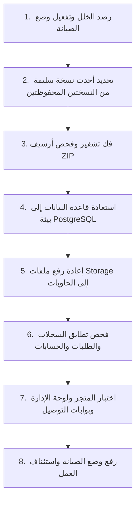

# خطة ودليل استعادة الكوارث | رَواق RAWAQ Disaster Recovery Playbook

## 1. مبادئ خطة الطوارئ
في حال حدوث أي طارئ لقاعدة الإنتاج (تعطل Supabase، تلف بيانات، أو هجوم سيبراني)، يتم تفعيل هذه الخطة لإعادة متجر رَواق للعمل بكامل كفاءته دون فقدان البيانات التجارية.

---

## 2. الخطوات الإجرائية الفورية (Step-by-Step Recovery)



### الخطوة 1: إيقاف استقبال الطلبات وتفعيل وضع الصيانة
- إيقاف استقبال الطلبات الجديدة مؤقتاً لتجنب تضارب البيانات أثناء الاستعادة.
- تعطيل إرسال إيميلات الإشعارات القديمة لتفادي تكرار إرسال طلبات أو فواتير سابقة.

### الخطوة 2: تحديد أحدث نسخة معتمدة
- استعراض النسخ المتاحة من لوحة Neon أو التخزين المستقل R2 / S3.
- اختيار أحدث نسخة معتمدة تحمل بادئة `BKP-YYYYMMDD-XXX`.

### الخطوة 3: فك تشفير أرشيف النسخة الاحتياطية
يتم فك تشفير الملف المشفر `.zip.enc` باستخدام مفتاح التشفير المعتمد:
```bash
# استخدام أداة فك التشفير المدمجة في رَواق:
npx tsx -e "
import { decryptFile } from './scripts/backup/encrypt-backup';
const key = process.env.BACKUP_ENCRYPTION_KEY || 'rawaq-secure-backup-aes-key-2026-secret-vault';
decryptFile('archives/RAWAQ-FULL-BACKUP-BKP-XXXX.zip.enc', 'restored.zip', key);
"
```
أو باستخدام OpenSSL:
```bash
openssl enc -d -aes-256-cbc -in RAWAQ-FULL-BACKUP-BKP-XXXX.zip.enc -out restored.zip -k <YOUR_ENCRYPTION_KEY>
```

### الخطوة 4: استعادة قاعدة البيانات
- استخراج ملف `dump.sql` من داخل مجلد `database/` في الأرشيف المفكوك.
- استعادة البيانات إما مباشرة من Neon (حيث تكون الجداول مستعادة بالفعل ومطابقة داخل مخطط النسخة المعزول `backup_xxx`)، أو عبر تشغيل السكريبت في قاعدة Supabase جديدة:
```bash
psql "$DIRECT_URL" -f database/dump.sql
```

### الخطوة 5: استعادة ملفات Storage
- إعادة رفع ملفات المجلد `storage/` إلى الحاويات المقابلة لها:
  - `brand-assets`
  - `product-images`
  - `uploads`
  - `invoices`
  - `official-reports`

### الخطوة 6: مطابقة وسلامة البيانات
- التحقق من تطابق أعداد السجلات عبر ملف `database/tables-summary.json`.
- التحقق من سلامة البصمات الإلكترونية عبر `checksums.sha256`.

### الخطوة 7: الاختبار النهائي وإعادة التشغيل
- تجربة تسجيل دخول الإدارة عبر `/admin/login`.
- فحص ظهور المنتجات والصور في المتجر الإلكتروني.
- فحص صفحة إدارة الطلبات `/admin/orders` والماليات `/admin/financials`.
- بعد الاعتماد الرسمي، يتم إيقاف وضع الصيانة وإطلاق الموقع مجدداً.

---

## 3. معلومات الاتصال والنطاقات الرسمية المعتمدة
- **الموقع الرسمي لمتجر رَواق (الرئيسية)**: https://www.rawaq-jo.online/ar
- **النطاق المعتمد للوحة الإدارة**: https://www.rawaq-jo.online
- **لوحة إدارة النسخ الاحتياطية**: https://www.rawaq-jo.online/admin/backups
- **البريد الإداري الرسمي**: rawaq.rq@gmail.com
- **لوحة Neon الاحتياطية**: https://console.neon.tech
- **لوحة Resend**: https://resend.com
- **لوحة Supabase**: https://supabase.com/dashboard
